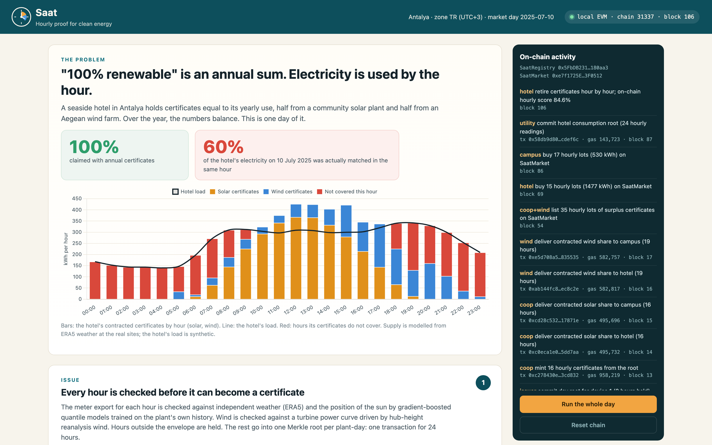
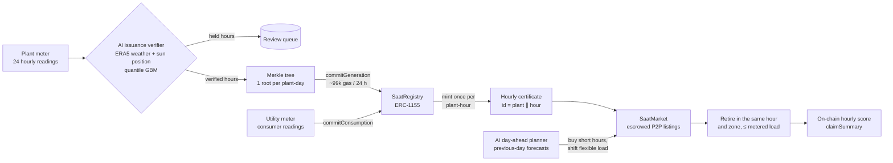

# Saat — hourly proof for clean energy

*Saat* is Turkish for "hour".

Companies say they run on "100% renewable" electricity because they bought certificates equal to their **annual** use. But electricity is consumed **hour by hour**. A solar megawatt-hour from a June noon cannot have powered a server at midnight in January. Saat is an hourly clean-energy certificate system:

- an **AI verifier** checks every metered hour against independent weather data before it can become a certificate;
- **Merkle-committed issuance** puts one root per plant-day on-chain, and each hour becomes an ERC-1155 certificate that can be minted only once;
- a **peer-to-peer market** trades hourly certificates;
- an **AI day-ahead planner** buys the hours a consumer will be short of and moves flexible load into surplus hours;
- **hourly retirement** burns a certificate only against the consumer's metered load in the same hour and the same grid zone, and computes the hourly carbon-free score on-chain.

**Track:** Renewable Energy & Energy Trading (renewable certificate tracking, P2P trading, tokenized incentives). It also serves Carbon Markets & Emissions Transparency (smart contracts that prevent double counting).



---

## The problem, measured on real data

**Across 22 U.S. grid regions in 2025, "100% renewable" covers a median 65.5% of electricity in the same hour.**
We took every U.S. balancing authority in EIA-930 with more than 20 TWh of demand and more than 3% wind and solar. A consumer with a flat 24/7 load (a data centre, say) buys wind and solar certificates equal to 100% of its annual use, as a pro-rata slice of its own region's real hourly fleet output. Under annual accounting it reports 100%. Hour by hour:

| | median | range |
|---|---|---|
| Load matched in the same hour (wind + solar) | **65.5%** | 41.2% (CPLE) – 81.9% (PSCO) |
| Solar-only certificates | 43.7% | |
| Wind-only certificates | 71.9% | |
| Emissions reported as zero but drawn from the grid | **124 kg CO₂e per MWh consumed** | 30 – 291 |
| Certificates that land in hours with no matching load | 34.5% | |

To reach 90% hourly matching with the same portfolio, a buyer needs 1.4× to 7.3× its annual volume. In 7 of the 22 regions, 90% is out of reach at any volume up to 10×. Source: [`analysis/hourly_gap.py`](analysis/hourly_gap.py) → [`results/hourly_gap.json`](results/hourly_gap.json).

Hourly accounting is where the rules are heading. The GHG Protocol's Scope 2 revision put hourly matching out for public consultation, and in the U.S. PJM, ERCOT and CleanCounts already issue hourly certificates (per EnergyTag). Hourly certificates mean 8,760 records per meter per year. That calls for cheap issuance, a way to trade individual hours, and claims anyone can check.

## How Saat works



### Smart contracts ([`contracts/src`](contracts/src))

`SaatRegistry` (ERC-1155 + registry):
- An accredited issuer commits one Merkle root per **plant-day** (24 hourly leaves), together with the SHA-256 of the AI verification report and the number of hours held back. This costs about **99k gas per plant-day** instead of 24 separate issuances.
- Certificates are **minted lazily** from the root, with a Merkle proof, as ERC-1155 token `id = plantId << 64 | hour`, with 1 unit = 1 Wh. Each plant-hour can be minted **once**, even if a later root repeats it (the double-issuance guard). Minting can never exceed the plant's registered capacity.
- Days follow the zone's **local market day** (Türkiye: UTC+3), the way the market settles.
- The utility commits each consumer's 24 hourly readings once per day, and **the whole day's load enters the denominator immediately**, so a consumer cannot raise its score by proving only its good hours.
- `retire` burns certificates only if they come from **the same hour** and **the same zone** as the proven load, and never more than that hour's load. A noon certificate cannot cover 21:00, which reverts with `HourMismatch`.
- `claimSummary(meter, fromDay, toDay)` returns load, matched energy and the hourly score in basis points, computed on-chain.

`SaatMarket`: a seller lists one hour's certificates at a price per Wh. The certificates sit in escrow until bought or cancelled, so a listed hour cannot be sold twice. It is guarded against reentrancy.

There are 22 Foundry tests, including a fuzz test that matched energy never exceeds load and a test that a tampered amount fails its proof.

### AI issuance verifier ([`saat/verifier.py`](saat/verifier.py))

A blockchain makes a certificate permanent, but it cannot tell whether the meter reading behind it was true. Before an issuer commits a day, every hour is checked against an independent physical record: ERA5 reanalysis weather plus sun position and clear-sky irradiance (pvlib). The checks are gradient-boosted median and 99th-percentile models trained on the plant's own history. The rules:
- power while the sun is down;
- more than capacity;
- an hour above the 99th-percentile weather envelope;
- a day whose total, or whose **centre of mass in time**, departs from what the weather allows (the time-shift test);
- a 30-day drift test for persistent over-claiming.

Each decision is written to a report, and its hash goes on-chain with the root.

**Evaluated on a real plant:** PVDAQ system 9068, a 4.7 MW single-axis tracker plant in Kersey, Colorado (NREL / DOE Open Energy Data Initiative), with hourly AC output from 2017 to 2025. The model was trained on 2017–2022, calibrated on 2023 and tested on 16 months it never saw (Jan 2024 – Apr 2025). Fraud was simulated on the real test data ([`analysis/verifier_eval.py`](analysis/verifier_eval.py)):

| Fraud | Capacity check (today's typical rule) | Saat AI: fake energy that never becomes a certificate |
|---|---|---|
| Power claimed after sunset | 0% | **100%** |
| Output relabelled 2 hours later (into scarcer evening hours) | 0% | **81%** |
| One hour inflated ×1.5 | 0% | **70%** |
| Every hour +50% | 0% | **63%** |
| A sunny day's readings replayed on a cloudy day | 0% | **48%** |
| Every hour +20% | 0% | 31% |
| Real energy wrongly held back | 0% | **0.52%** |

- **Accuracy:** hourly error is 10.4% of capacity, against 18.0% for a physics model alone (R² 0.75 vs 0.42).
- **Persistent inflation:** the 30-day drift test catches 94% of persistent +30% inflations within 90 days, with zero false alarms over 424 clean days.
- **Limit:** small uniform inflation (≤10%) hides inside weather uncertainty. Settlement-grade meters and the grid operator's own readings stay the first line of defence. The verifier covers what metering does not: relabelled hours, replayed days, impossible output, and self-reported meters such as rooftop and community solar.

### AI day-ahead planner ([`saat/planner.py`](saat/planner.py))

- **What it sees:** only what was known the day before, namely Open-Meteo's archived previous-day forecasts (`*_previous_day1`).
- **Supply forecast:** gradient boosting corrects the physical forecast of each plant. For the wind share, its error is **4.9%** of capacity, against 7.0% for physics on the forecast and 11.2% for persistence.
- **Load shifting:** a greedy water-filling step moves flexible load (laundry, pool pumps, water heating, shuttle charging) from forecast-deficit hours into forecast-surplus hours. Each day's energy is unchanged.
- **Buying:** the planner then buys the remaining forecast shortfall, hour by hour, from the cheapest listings.

## The Antalya demonstration

Türkiye hosts COP31 in Antalya in November 2026. The demo community sits in Türkiye's single bidding zone (TR):

- a 2 MW community solar plant in Antalya;
- a 6 MW share of an Aegean wind farm (Karaburun);
- a seaside hotel (Lara);
- a technopark office campus.

Both consumers hold certificates equal to 100% of their annual use, split half solar and half wind. Generation is **modelled from real hourly ERA5 weather** at those coordinates (pvlib PVWatts; a generic 3.5 MW-class turbine curve). The two load profiles are **synthetic** (temperature-driven, following Antalya's tourist season). No real company is depicted.

**All of 2025, hour by hour** ([`analysis/antalya_eval.py`](analysis/antalya_eval.py)):

| | hourly matched |
|---|---|
| Annual claim | 100% |
| Each consumer alone | 64.4% |
| + P2P trading of surplus hours between them | 66.3% |
| + AI day-ahead load shifting (previous-day forecasts) | **69.7%** |
| Same, with perfect foresight | 70.8% |

The planner recovers 76% of what perfect foresight would. The headroom left above 70% is why the hourly market matters: it lets the hotel buy night-time wind it would otherwise never see.

**The demo day (10 July 2025) on a live local chain:**
- **Before trading:** the hotel's own contract covers **59.9%** of its load hour by hour.
- **After trading:** after the plants deliver contracted shares and list their surplus, the planner moves 600 kWh into the midday surplus and buys evening wind certificates. The on-chain score is **84.6%**.
- **Tampering:** a meter export shifted by two hours has the whole day held back. Power claimed after sunset is held in the exact two hours.

## Run it

Requirements: macOS or Linux, [uv](https://docs.astral.sh/uv/), [Foundry](https://book.getfoundry.sh/) (`forge`, `anvil`).

```bash
git clone --recursive https://github.com/yy5652-hash/saat && cd saat
uv sync
(cd contracts && forge test)          # 22 contract tests
uv run pytest                         # 19 Python tests, including a full flow on Anvil
uv run uvicorn app.server:app --port 8417
```

Open http://localhost:8417 and press **Run the whole day**, or go step by step. The server starts its own Anvil chain, deploys the contracts and registers the community. The first start downloads the weather data and trains the models (about a minute); later starts take a second.

Reproduce the studies (each downloads its public data once into `data/raw/`):

```bash
uv run python analysis/hourly_gap.py      # EIA-930, 22 balancing authorities, 2025
uv run python analysis/verifier_eval.py   # PVDAQ 9068 + ERA5, simulated fraud
uv run python analysis/antalya_eval.py    # Antalya community, 2025
```

## Who uses it, and how it scales

- **Registries and grid operators** (in Türkiye, EPİAŞ already issues YEK-G guarantees of origin per MWh): commit one root per plant-day from settlement meter data they already hold. Saat adds hourly granularity, local market days, and a public double-issuance and double-claim guard.
- **Renewable generators and energy communities:** sell the hours that are worth most, not an anonymous annual MWh. Rooftop and cooperative solar, which lack settlement-grade metering, are where the AI verifier earns its keep.
- **Corporate buyers** (hotels, data centres, factories exporting under carbon border rules): buy the hours they are short of, move flexible load, and publish a claim anyone can recompute from the chain.
- **Auditors and the public:** `claimSummary` and the events are the audit trail. The verifier report hash ties every certificate to the evidence it passed.

**Scale:**
- **Issuance cost:** one transaction per plant per day; minting is lazy, so only certificates that are traded or retired ever touch the chain.
- **Measured gas:** commit 99k per plant-day, mint 40–50k per hour in a batch, retire ~66k per hour.
- **Where it can run:** the contracts are plain Solidity 0.8 and OpenZeppelin 5, deployable on any EVM chain, including low-fee rollups or a permissioned network run by a registry.

## Repository

```
contracts/      SaatRegistry, SaatMarket, Foundry tests
saat/           merkle (byte-compatible with Solidity), chain client, verifier, planner,
                pvmodel, scenario (Antalya), matching, data sources
analysis/       the three studies; results/ holds their outputs
app/            FastAPI server and dashboard (Chart.js vendored)
tests/          Python tests, including an end-to-end run on Anvil
```

## Data and licences

| Data | Source | Terms |
|---|---|---|
| Hourly U.S. grid generation and demand, 2025 | EIA-930 six-month files, U.S. Energy Information Administration | Public domain |
| Measured PV output, system 9068 | NREL PVDAQ, DOE Open Energy Data Initiative | CC BY 4.0 |
| Hourly reanalysis weather (ERA5) and previous-day forecasts | Open-Meteo archive and previous-runs APIs | CC BY 4.0, non-commercial API use |
| Life-cycle emission factors | IPCC AR5 WG3 Annex III medians; oil/other per Electricity Maps defaults | cited |

Code: MIT. The demo runs on a local test chain; "ETH" amounts are test values.

## Limitations

- **Antalya data:** supply is modelled from weather rather than metered, and the loads are synthetic. The real-data claims in this README come from the EIA-930 and PVDAQ studies.
- **Emissions:** the hidden-emissions estimate uses each region's average hourly intensity of its own generation and ignores imports.
- **Verifier coverage:** the verifier is evaluated on one real plant. Small persistent inflation needs settlement meters or peer comparison across neighbouring plants.
- **Contract scope:** the contracts do not yet handle storage-shifted certificates, cross-zone deliverability rules or certificate expiry.
